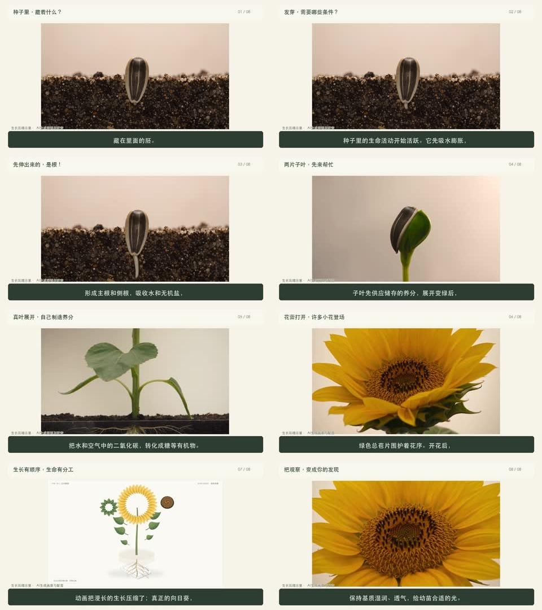

# 豆包科普视频 Skill

将一个科学过程、结构拆解或 Anatomy 交互演示，制作成面向中小学生的中文科普视频。

流程：事实核查 → 口播与解释文案 → 分镜和科学约束 → 豆包视频生成 → 音色试听与逐段配音 → 按真实声音剪辑 → 字幕与 AI 标识 → 技术检查与播放验收。

入口：[SKILL.md](doubao-science-video/SKILL.md)。

## 安装到 Codex

在终端执行（需要 Git；若已安装同名 Skill，请先自行备份或移开旧版本）：

```bash
git clone --depth 1 https://github.com/foxbitcoo/doubao-science-video-skill.git
mkdir -p "${CODEX_HOME:-$HOME/.codex}/skills"
test ! -e "${CODEX_HOME:-$HOME/.codex}/skills/doubao-science-video" && \
  cp -R doubao-science-video-skill/doubao-science-video "${CODEX_HOME:-$HOME/.codex}/skills/"
```

重新开启 Codex 会话后即可调用。也可以直接让 Codex 使用内置 Skill Installer 安装：

> 安装 https://github.com/foxbitcoo/doubao-science-video-skill/tree/main/doubao-science-video

安装 Skill 本身不需要豆包 Key。实际生成视频或配音时，需要使用者自己的模型账户权限。

## Demo：向日而生

[播放或下载完整科普视频（约92秒，720p）](demo/sunflower-science.mp4)



实际制作示例：豆包 Seedance 画面、豆包 TTS 2.0 Vivi 女声、中文字幕及持续 AI 标识，另包含 Anatomy 结构示意。生长时间经压缩，部分结构比例为教学示意。

GitHub 如果未直接显示播放器，可点击视频文件页的下载按钮播放本地文件。


调用示例：

> 使用 $doubao-science-video，把向日葵从种子萌发到开花的过程做成约90秒科普视频，使用亲和力女生配音，交付视频、口播稿和解释文案。

包内包含通用写作准则、豆包视频和语音执行路径、FFmpeg合成脚本。需要具备相应账户权限与当前可用的模型；本 Skill 不附带 API Key、不自动开通付费服务，也不保证控制台界面或模型目录永久不变。Anatomy 示意素材可选，不把该项目打包为依赖。

本地脚本已用合成音视频验证渲染、整片解码、覆盖保护及字幕文本不一致时拒绝输出；这不替代真实内容的科学审阅与试听。

仓库仅附公开展示的成片 Demo 和预览图，不包含私人凭据、历史任务ID、账号配置、原始生成素材、账单或制作日志。
