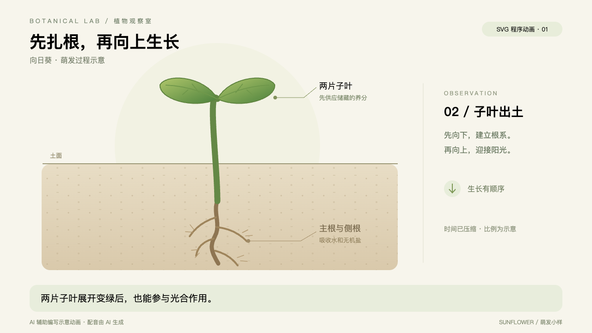
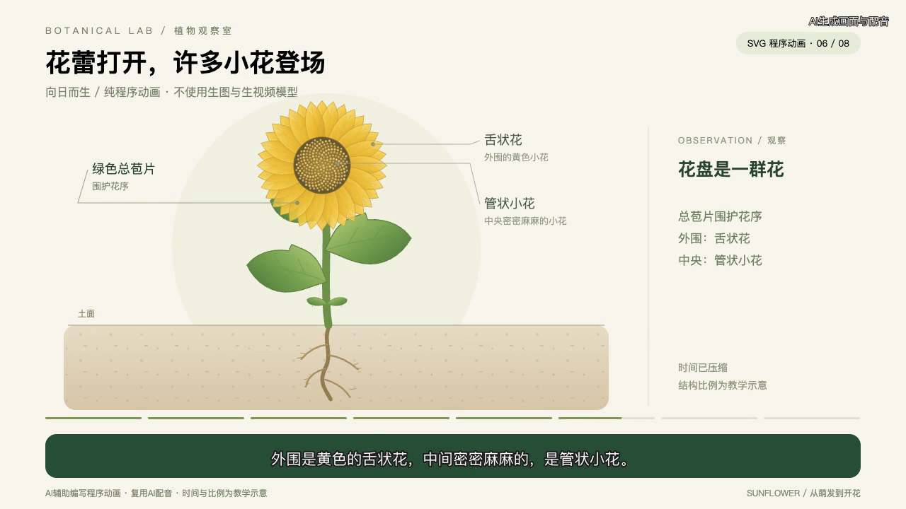
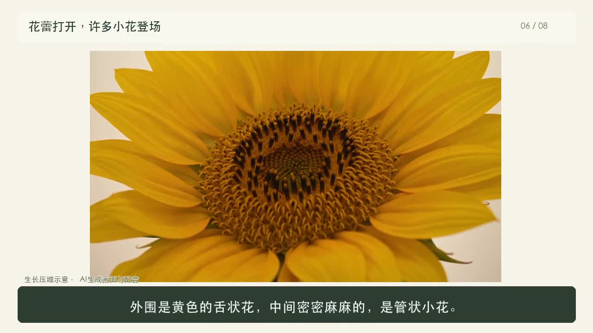

# 豆包科普视频 Skill

将教育教学PPT、科学过程、结构拆解或Anatomy演示，制作成中文教学动画和配音字幕视频。**默认纯程序动画，只有使用者明确要求时才调用生图或生视频模型。**

流程：事实核查 → 口播与解释文案 → 分镜和科学约束 → SVG动画或豆包视频 → 音色试听与逐段配音 → 按真实声音剪辑 → 字幕与 AI 标识 → 技术检查与播放验收。

入口：[SKILL.md](doubao-science-video/SKILL.md)。

## 两种制作方案

| 方案 | 画面来源与交付 | 成本提示 |
|---|---|---|
| **纯程序动画（默认）** | 用代码制作结构、生长、拆解等示意，交付交互网页及配音字幕MP4 | SVG画面无视频模型调用费；仍有Agent、制作、本地渲染和可能的配音成本 |
| **豆包视频（明确要求时）** | 主要讲解画面全部由豆包视频模型生成，再合成配音、字幕和标签 | **通常比较贵**：生成秒数、分辨率、模型和废弃重做镜头都会影响费用，须先估算再执行 |

两种方案都保留。未指定时只用HTML/SVG/JavaScript绘制与本地渲染，生图和生视频调用次数均为0；不会自动混入豆包镜头。用户明确要求后可选择豆包全片或混合方案，仍须先说明费用。

生图、生视频按模态分别启用：允许生视频不代表允许额外生图，反之亦然。“做动画”“更写实”“用豆包配音”或设定预算不等于启用生图/生视频。两种方案最终都可交付MP4，“纯视频”指画面制作方式，不是文件格式。

纯视频同样受默认20元预算与重试上限约束。若完整制作预计超预算，会先说明差额和调整选项；选择纯视频不等于同意自动加预算，也不会擅自换成SVG。不要将现有Demo或混合方案的低预算估算视为纯视频的成本承诺。

调用示例：

> 使用SVG方案制作一个植物萌发科普动画，配上女声和字幕。
>
> 使用纯视频方案制作一段科普短片，先说明成本风险并估算费用；未明确调整前预算上限20元。

## 默认降本策略

默认全部用本地程序动画，不强制生成任何视频秒数。只有明确要求使用生成模型时，才对指定模态估价和调用；普通镜头优先评估低成本模型，困难镜头再考虑升级。

- 每条直接模型调用预算上限 **20元**：视频、图片、配音、样本和重试一起计算。
- 首轮计划尽量不超过15元，至少留5元余量；每次提交前检查已花费用和在途任务的预留费用。
- 单镜头最多首次生成加1次修订重试；全片最多2次视频重试，预算先到则先停止付费生成。
- 无法确认费用或预算不够时，SVG/混合方案用准确示意动画完成；纯视频方案先报告缺口和调整选项。提高预算需用户明确授权。

详见 [预算与重试控制](doubao-science-video/references/budget.md)。这是 Agent 执行规则，不是云账户的强制扣费上限；实际费用仍以账单为准。

## SVG 动画通路

无需调用视频生成模型，也可用本包的SVG程序动画制作成片：

`SVG/HTML + renderFrame(t) → 逐帧导出MP4 → 配音与字幕合成`

- [可交互向日葵模板源码](doubao-science-video/assets/sunflower-svg/scene.html)：播放、拖动、拆开及组装。
- [依赖安装及导出说明](doubao-science-video/references/svg.md)。
- [SVG配音字幕小样（约21秒）](demo/sunflower-svg.mp4)，复用已有配音，没有新增视频或语音模型调用。



SVG图形本身无视频API费用；仍有Agent、代码制作、本地渲染与可能的配音成本，不能把它等同于总成本为零。

## 教育教学PPT转动画

推荐工作流：

`读取课件及讲稿 → 提炼一个教学目标 → 选择值得动态解释的过程 → 带来源页码的分镜 → 代表片段预览 → 配音定时 → 程序动画成片 → 教学与技术验收`

- **按教学目标组织**：明确“学生看完能解释或判断什么”，不是把整份PPT逐页播一遍。
- **把关系变成动作**：用路径生长、分层拆解、变量变化、对照或因果过程，选择适合学科的动画，不强行套植物模板。
- **课件内容可追溯**：概念、图表、公式、讲者备注关联来源页；原课件与补充解释分开，缺失或模糊内容不猜。
- **先看关键样片**：先给代表片段或关键帧，便于教师纠正方向，再扩展完整片；有完整授权可继续制作，不强制每步确认。
- **修改只影响相关部分**：保留稳定场景ID；配音、字幕不变时直接复用，局部改画面不重做所有素材。
- **支持课堂使用**：交付MP4；需要时附可暂停、拖动、拆解或调参的交互HTML，两个输出共用同一时间轴。

详见 [教学PPT转动画工作流](doubao-science-video/references/teaching-ppt.md)。目前已验证程序动画导出和配音字幕合成；PPT入口是面向Agent的读取与教学设计流程，并非已经实现任意PPT一键自动转换。尚未用真实教学课件完成端到端验收。

## 安装到 Codex

在终端执行（需要 Git；若已安装同名 Skill，请先自行备份或移开旧版本）：

```bash
git clone --depth 1 https://github.com/foxbitcoo/doubao-science-video-skill.git
mkdir -p "${CODEX_HOME:-$HOME/.codex}/skills"
test ! -e "${CODEX_HOME:-$HOME/.codex}/skills/doubao-science-video" && \
  cp -R doubao-science-video-skill/doubao-science-video "${CODEX_HOME:-$HOME/.codex}/skills/"
```

重新开启 Codex 会话后即可调用。也可以直接让 Codex 使用内置 Skill Installer 安装：

> 安装 https://github.com/foxbitcoo/doubao-science-video-skill/tree/main/doubao-science-video

安装 Skill 本身不需要豆包 Key。实际生成视频或配音时，需要使用者自己的模型账户权限。

## Demo：向日而生 · 两种方案对照

两版讲解相同的8个阶段，使用同一套 Vivi 女声配音和口播稿，均为720p，含中文字幕和AI标识。

| | 纯程序动画完整版 | 原豆包视频版 |
|---|---|---|
| 播放 / 下载 | [完整程序动画（约90秒）](demo/sunflower-program-full.mp4) | [豆包视频成片（约92秒）](demo/sunflower-science.mp4) |
| 预览 |  |  |
| 画面制作 | Codex编写HTML/SVG/JavaScript，本地浏览器逐帧渲染，FFmpeg合成；未调用生图或生视频模型 | 豆包Seedance生成主要画面，结合少量Anatomy结构示意，再合成配音字幕 |
| 效果特点 | 插画式示意，结构、标签和动作顺序容易精确控制，适合讲解因果与拆解 | 更有写实质感和自然运动表现，生成结果仍需逐段检查科学正确性 |
| 成本区别 | 画面无生图/生视频API调用费；本例复用已有配音。仍有Agent使用、代码制作、本地渲染成本，新做配音可能另计 | 生成镜头需要模型费用，成功但被弃用的镜头也可能计费；通常比程序动画方案贵，须先估算 |
| 修改与复用 | 可修改源代码后重新渲染，源网页还能保留交互；MP4本身没有交互 | 剪辑和字幕可复用；更改主体动作或结构常需重新生成镜头 |

纯程序动画版覆盖种子内部、萌发条件、胚根、子叶、真叶与光合作用、开花、器官分工、观察记录。所有动画都是教学示意：生长时间经过压缩，尺寸和数量不代表精确实物比例。

原豆包视频Demo在引入默认预算规则前制作，不代表预算上限内的制作效果或成本承诺。两版都不能用来推算其他题材的固定制作价格。

GitHub如果未直接显示播放器，可点击视频文件页的下载按钮播放本地文件。另有[约21秒SVG小样](demo/sunflower-svg.mp4)，用于快速了解程序动画效果。


调用示例：

> 使用 $doubao-science-video，把向日葵从种子萌发到开花的过程做成约90秒科普视频，使用亲和力女生配音，交付视频、口播稿和解释文案。

包内包含通用写作准则、豆包视频和语音执行路径、FFmpeg合成脚本。需要具备相应账户权限与当前可用的模型；本 Skill 不附带 API Key、不自动开通付费服务，也不保证控制台界面或模型目录永久不变。Anatomy 示意素材可选，不把该项目打包为依赖。

本地脚本已用合成音视频验证渲染、整片解码、覆盖保护及字幕文本不一致时拒绝输出；这不替代真实内容的科学审阅与试听。

仓库仅附公开展示的成片 Demo 和预览图，不包含私人凭据、历史任务ID、账号配置、原始生成素材、账单或制作日志。
